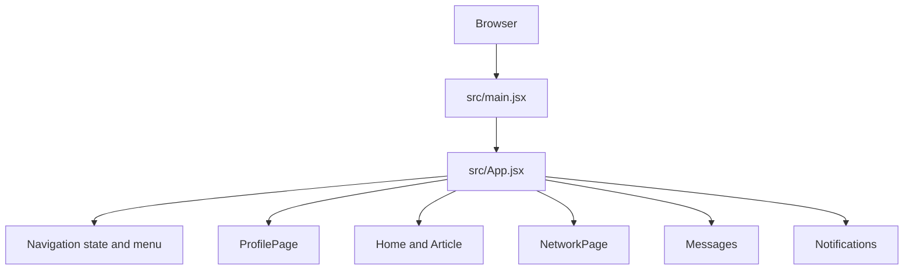
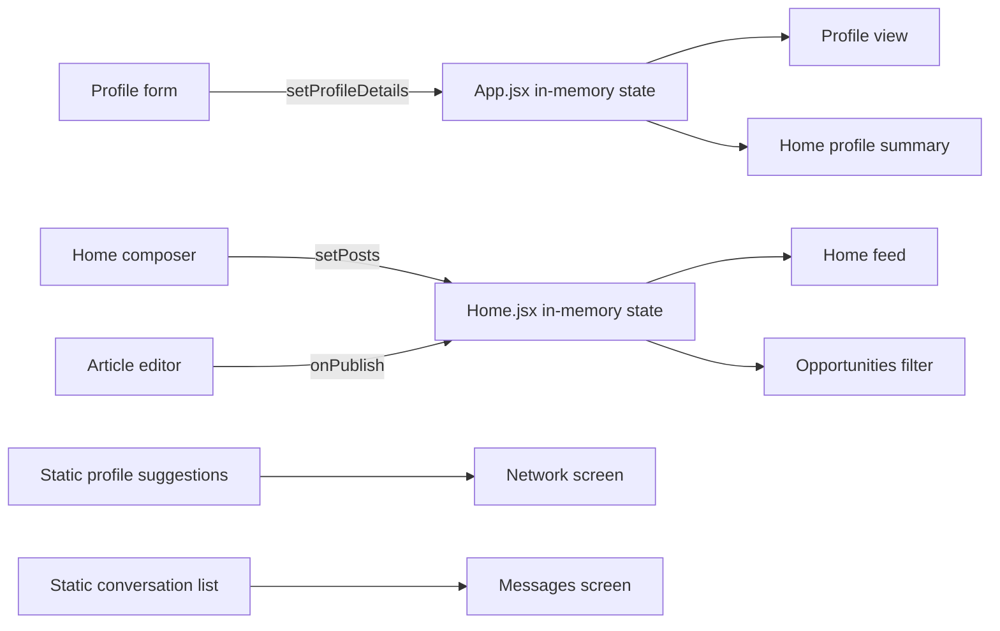
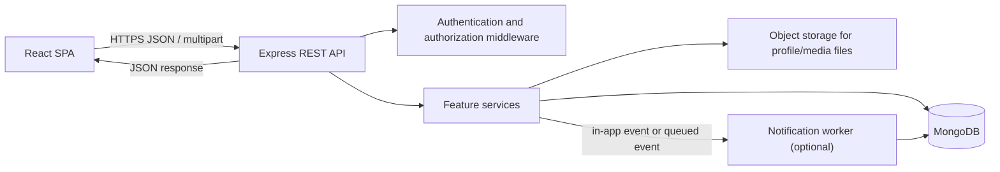

# TrueHunt Backend Flow

## 1. Purpose and scope

This document describes:

1. The data and screen flows that the current application implements.
2. What is not implemented on the backend today.
3. A proposed backend flow for making profiles, posts, opportunities, connections, messages, and notifications persistent and available to multiple users.

The proposed API, collections, and request sequences below are a design recommendation. They are not existing endpoints or database models.

## 2. Current application architecture

The current project is a React 19 single-page application built with Vite. Its package manifest contains React, Vite, and UI libraries, but no Express, database driver/ODM, authentication SDK, or API client. The Vite configuration only registers the React plugin.

Current runtime flow:



`App.jsx` owns navigation, profile details, and the profile image preview. It renders the screen components and passes profile data and callbacks down as props. There is currently no API request between the browser and a server.

| Feature | Current implementation | Persistence today |
|---|---|---|
| Navigation | `activeNavigation` state in `App.jsx` | Browser memory only |
| Artist profile | Form and profile display in `ProfilePage.jsx`; shared profile object is owned by `App.jsx` | Browser memory only |
| Profile image and demo videos | Browser file selection and `URL.createObjectURL` previews | Temporary browser object URLs; no file upload |
| Home posts and opportunities | `posts` state in `Home.jsx`; `type` distinguishes ordinary posts, articles, and opportunities | Browser memory only; not visible to other users |
| Articles | `Article.jsx` collects a title, text, and optional attachment, then passes the result to Home | Browser memory only |
| Network | Suggested users are static sample data; connected IDs are component state in `NetworkPage.jsx` | Browser memory only |
| Messaging | Initial conversations are sample data; composing adds an in-memory item in `Messages.jsx` | Browser memory only; messages are not sent to another user |
| Notifications | Empty notification content in `Notifications.jsx` | No notification data source |
| Settings | Placeholder screen rendered by `App.jsx` | No settings API |

The profile form currently checks each uploaded demo video against a 5 MB limit in the browser. The Article composer accepts image, video, audio, and document attachments. Browser-side checks are useful for user experience but cannot replace server-side validation.

### Current data boundary



The opportunity feed is a filtered view of the posts held by the current `Home` component. An opportunity is distinguished by `type: "opportunity"`. It is not currently a separate database record, and it is not shared between browsers or users.

## 3. Recommended backend architecture

For the existing React frontend, a conventional MERN-style API can be added without moving page navigation to the server:



Suggested responsibilities:

- **React client:** collect input, call the API, show loading/success/error states, and render server responses. Treat client state as a cache, not the source of truth.
- **Express API:** authenticate requests, validate input, enforce ownership/visibility rules, and return consistent JSON responses.
- **Feature services:** implement profile, feed, opportunity, network, messaging, and notification rules.
- **MongoDB:** persist user and application records.
- **Object storage:** store images, videos, audio, and documents. Store object keys/URLs and metadata in MongoDB; do not store raw large files as normal profile document fields.
- **Notification worker:** optional initially; useful when notifications need to be created asynchronously for new messages, connection requests, or opportunity activity.

## 4. Proposed domain records

These are logical collections, not existing schemas. ObjectId fields are illustrative.

### User

```text
User {
  _id,
  email,                 // unique; normalized
  passwordHash,          // never return from API
  status,                // active, suspended, deleted
  createdAt,
  updatedAt
}
```

Authentication credentials should be kept separate from public profile details.

### Profile

```text
Profile {
  _id,
  userId,                 // unique reference to User
  name,
  phone,
  email,
  experience,
  address,
  languages[],
  otherLanguage,
  talents[],
  workTypes[],
  profileImageKey,
  coverImageKey,
  demoVideos[]: { objectKey, url, fileName, contentType, sizeBytes },
  videoUrls[],
  visibility,             // public or private
  createdAt,
  updatedAt
}
```

Keep contact fields private by default. Return them only where the requesting user is authorized.

### Post and opportunity

Use one feed record with a validated discriminator initially, matching the current Home component's `type` field. A separate Opportunity collection can be introduced if requirements later need expiry, applications, compensation, employer, or structured job-search fields.

```text
Post {
  _id,
  authorId,                // User reference
  type,                    // post, article, opportunity
  title,                   // required for article; optional for other types
  content,
  attachments[]: { objectKey, url, fileName, contentType, sizeBytes },
  visibility,
  createdAt,
  updatedAt
}
```

If `type` is `opportunity`, the record is returned by the opportunities feed. Do not create seeded or mock jobs in production; return an empty list when no real opportunity records exist.

### Network, messaging, and notification records

```text
Connection {
  _id,
  requesterId,
  recipientId,
  status,                  // pending, accepted, rejected, blocked
  createdAt,
  updatedAt
}

Conversation {
  _id,
  participantIds[],
  lastMessageAt,
  createdAt
}

Message {
  _id,
  conversationId,
  senderId,
  body,
  attachments[],
  readAt,
  createdAt
}

Notification {
  _id,
  recipientId,
  actorId,
  type,                    // connection_request, connection_accepted, message, etc.
  resourceType,
  resourceId,
  readAt,
  createdAt
}
```

Recommended constraints include unique user email, one profile per user, no self-connections, no duplicate active connection pair, and conversation membership checks before reading or sending messages.

## 5. Proposed API surface

All routes below are recommendations. Protect routes that read or mutate private/user-owned data with authentication. The API should derive the current user's ID from the authenticated session/token rather than trusting a `userId` supplied by the browser.

| Area | Example endpoint | Purpose |
|---|---|---|
| Authentication | `POST /api/auth/register` | Create a user and initial empty profile |
| Authentication | `POST /api/auth/login` | Authenticate and issue a secure session |
| Authentication | `POST /api/auth/logout` | End the session |
| Authentication | `GET /api/auth/me` | Return the signed-in user's public account/profile data |
| Profile | `GET /api/profiles/:userId` | Read a profile subject to visibility rules |
| Profile | `PATCH /api/profiles/me` | Validate and update the authenticated user's profile |
| Profile media | `POST /api/media/upload` | Upload file or request an authorized upload URL |
| Feed | `GET /api/posts?cursor=...` | Read visible ordinary posts/articles |
| Feed | `POST /api/posts` | Create an ordinary post |
| Feed | `POST /api/posts/:postId/media` | Attach uploaded media if using a two-step upload |
| Opportunities | `GET /api/opportunities?cursor=...` | Return only real `type=opportunity` records |
| Opportunities | `POST /api/opportunities` | Create an opportunity from the authenticated user |
| Network | `GET /api/connections/suggestions` | Return eligible suggested profiles |
| Network | `POST /api/connections` | Request a connection |
| Network | `PATCH /api/connections/:connectionId` | Accept/reject a request |
| Network | `GET /api/connections` | List accepted connections |
| Messaging | `GET /api/conversations` | List conversations for the signed-in user |
| Messaging | `GET /api/conversations/:id/messages?cursor=...` | Read messages after membership check |
| Messaging | `POST /api/conversations/:id/messages` | Send a message and create a recipient notification |
| Notifications | `GET /api/notifications?cursor=...` | List notifications for the signed-in user |
| Notifications | `PATCH /api/notifications/:id/read` | Mark one notification read |
| Notifications | `PATCH /api/notifications/read` | Mark notifications read in bulk |

Suggested successful response shape:

```json
{
  "data": {},
  "meta": {
    "nextCursor": null
  }
}
```

Suggested error response shape:

```json
{
  "error": {
    "code": "VALIDATION_ERROR",
    "message": "Check the submitted fields.",
    "fields": {
      "content": "Content is required."
    }
  }
}
```

Use HTTP status codes consistently: `400` invalid input, `401` unauthenticated, `403` unauthorized, `404` missing/invisible resource, `409` conflicting state, and `500` unexpected server failure. Do not return stack traces or secrets to the client.

## 6. Main request flows

### A. Sign in and load the application

1. The browser submits credentials to `POST /api/auth/login`.
2. The API validates credentials and establishes a secure session (prefer an HttpOnly, Secure, SameSite cookie) or returns a short-lived access token under an agreed token strategy.
3. The client calls `GET /api/auth/me`.
4. The API returns the signed-in account and permitted profile fields.
5. The client loads the Home feed, opportunities, and notification count as needed.
6. Every protected API request is authorized from the authenticated identity; hidden UI controls do not count as access control.

### B. Update profile and upload demo videos

1. `ProfilePage` gathers form fields and selected files.
2. The client performs immediate usability checks, including the existing 5 MB per-demo-video check.
3. The client uploads files to the API or obtains short-lived, scoped object-storage upload URLs.
4. The server validates file size, actual content type, extension, ownership, and upload authorization. It stores files in private/object storage and returns storage references.
5. The client sends `PATCH /api/profiles/me` with profile fields and uploaded media references.
6. The server validates fields, checks ownership, updates the profile, and returns the canonical saved profile.
7. App state is replaced with the server response; profile views use persisted URLs/keys, not temporary `blob:` URLs.

### C. Publish a post, article, or opportunity

1. The user selects the content type in Home or Article.
2. If there are attachments, the client uploads them using the media flow above.
3. The client sends `POST /api/posts` or `POST /api/opportunities` with the content and attachment references.
4. The API authenticates the author, validates content and attachment references, and creates the record with a server-generated ID, author, and timestamp.
5. The response contains the canonical record; the client inserts it into its feed cache.
6. Home requests ordinary posts/articles. Opportunities requests only opportunity records. Both feeds paginate newest-first using a cursor.
7. When there are no saved opportunities, the API returns an empty list and the UI shows its empty state. It must not substitute sample jobs.

### D. Connect with another user

1. The client requests suggestions from `GET /api/connections/suggestions`.
2. The user selects Connect; the client sends `POST /api/connections` with the recipient profile ID.
3. The server rejects self-connections and duplicates, creates a pending connection request, and creates a notification for the recipient.
4. The recipient accepts or rejects through `PATCH /api/connections/:connectionId`.
5. The server verifies the recipient is allowed to update this request. On acceptance, both users see the connection and may start messaging if permitted.

### E. Send and read messages

1. The client lists only the signed-in user's conversations.
2. Before returning conversation messages, the server verifies the user is a participant.
3. The client sends a message through `POST /api/conversations/:id/messages`.
4. The server validates membership and content, persists the message, updates `lastMessageAt`, and creates a recipient notification.
5. The recipient fetches new messages or receives them through a later real-time channel (WebSocket/SSE can be added after REST works).
6. Mark messages read on the server and update `readAt`; do not rely only on a local unread flag.

### F. Notifications

1. A domain action (connection request/acceptance, message, or other supported event) creates a notification record.
2. The client calls `GET /api/notifications`.
3. The API returns only notifications whose `recipientId` is the authenticated user.
4. Mark-read requests update `readAt` after verifying notification ownership.
5. The UI refreshes or subscribes to notification changes; notification delivery must not expose private message content to unrelated users.

## 7. Data ownership and validation rules

- The server is authoritative for IDs, timestamps, ownership, visibility, and connection/message state.
- Never trust `authorId`, `senderId`, `recipientId`, or a profile's owner ID in the request body; derive or verify them from the session.
- Users may edit only their own profile and delete/edit only content they own, subject to moderation/admin rules.
- Validate required article title/content and non-empty post/opportunity content on the server.
- Validate opportunity type and fields against an explicit schema; do not accept arbitrary discriminator values.
- Enforce upload limits on the server. The current UI accepts profile demo videos up to 5 MB each, but client checks can be bypassed.
- Store uploaded media outside ordinary MongoDB documents and serve it through controlled public URLs or authorized access.
- Use cursor pagination for feeds, messages, and notifications; do not load an unbounded dataset.
- Add indexes for user email, profile userId, post type/createdAt, connection pairs/status, conversation participant IDs, and notification recipientId/createdAt.
- Rate-limit authentication, connection requests, messaging, and uploads. Apply spam/reporting controls before opening public posting to all users.

## 8. Suggested implementation order

1. Add server project structure, environment configuration, database connection, health endpoint, and centralized error handling.
2. Implement authentication and request identity middleware.
3. Implement Profile GET/PATCH, then connect the existing Profile form to the API.
4. Implement media upload/storage and replace object URL persistence assumptions with stored media references.
5. Implement posts and opportunities endpoints; connect Home and Opportunities feeds and preserve the empty-opportunities state.
6. Implement connections and suggestions with server-backed state.
7. Implement conversations/messages and notifications.
8. Add integration tests for authorization, validation, ownership, pagination, and upload limits before production deployment.

## 9. Source references

- Application entry and screen orchestration: [src/main.jsx](./src/main.jsx), [src/App.jsx](./src/App.jsx)
- Profile fields, local file handling, and profile updates: [ProfilePage.jsx](./src/assets/Components/ProfilePage.jsx), [profileDefaults.js](./src/assets/Components/profileDefaults.js)
- Home posts and opportunity filtering: [Home.jsx](./src/assets/Components/Home.jsx)
- Article editor and attachment selection: [Article.jsx](./src/assets/Components/Article.jsx)
- Static network suggestions and in-memory connections: [NetworkPage.jsx](./src/assets/Components/NetworkPage.jsx)
- Sample conversations and in-memory messaging: [Messages.jsx](./src/assets/Components/Messages.jsx)
- Notifications UI: [Notifications.jsx](./src/assets/Components/Notifications.jsx)
- Frontend dependencies and available scripts: [package.json](./package.json)
- Vite configuration: [vite.config.js](./vite.config.js)

## 10. Current implementation status

The project currently contains a frontend only. No backend is implemented or wired to these screens, and there are no configured API URLs, database models, authentication endpoints, or file-storage integration in the inspected application source. The recommended flows above require backend implementation before data can be shared across users or persist after a page reload.
